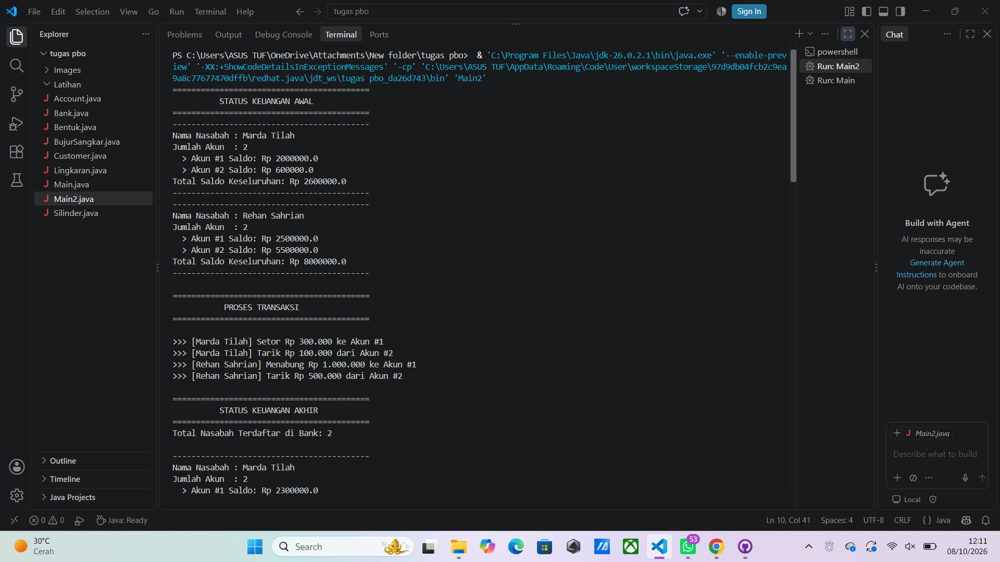

<div align="center">

# 🏦 Simulasi Sistem Perbankan Sederhana

**Aplikasi konsol Java berbasis OOP untuk mengelola nasabah, akun, dan transaksi bank.**


</div>

---

## 📖 Deskripsi

Proyek ini adalah simulasi sistem perbankan sederhana yang dibuat dengan **Java** menggunakan konsep **Object-Oriented Programming (OOP)**. Program memungkinkan sebuah bank menyimpan banyak nasabah, setiap nasabah memiliki banyak akun, dan setiap akun dapat melakukan **setor (deposit)** serta **tarik (withdraw)** saldo.

Seluruh data disimpan menggunakan `ArrayList`, sehingga jumlah nasabah dan akun bersifat dinamis.

---

## ✨ Fitur Utama

| Fitur | Keterangan |
|-------|------------|
| 👥 Multi-nasabah | Bank dapat menyimpan banyak nasabah sekaligus |
| 💳 Multi-akun | Satu nasabah dapat memiliki lebih dari satu akun |
| ➕ Setor saldo | Hanya menerima nominal **lebih dari 0** |
| ➖ Tarik saldo | Hanya berhasil jika **saldo mencukupi** |
| 🛡️ Validasi indeks | Mengembalikan `null` jika indeks nasabah/akun di luar jangkauan |
| 📊 Laporan saldo | Menampilkan rincian akun dan total saldo tiap nasabah |

---

## 🖼️ Tampilan Program

> 📌 **Tempat upload gambar:** ganti tautan di bawah dengan screenshot hasil program kamu.
> Caranya: tarik & lepas (drag & drop) gambar ke editor README di GitHub, lalu salin tautan yang muncul.

<div align="center">

<!-- 👇 GANTI GAMBAR DI BAWAH INI 👇 -->

<!-- 👆 GANTI GAMBAR DI ATAS INI 👆 -->

*Gambar: Tampilan output program di terminal*

</div>

---

## 🗂️ Struktur Proyek

```
📁 Simulasi-Bank
 ├── 📄 Account.java     → Menyimpan saldo, deposit & withdraw
 ├── 📄 Customer.java    → Data nasabah + daftar akun miliknya
 ├── 📄 Bank.java        → Mengelola daftar seluruh nasabah
 └── 📄 Main2.java       → Program utama & simulasi transaksi
```

### 🧩 Penjelasan Kelas

#### `Account`
Mewakili satu rekening.
- `getBalance()` → mengambil saldo saat ini
- `deposit(double amt)` → menambah saldo (`true` jika `amt > 0`)
- `withdraw(double amt)` → mengurangi saldo (`true` jika saldo cukup)

#### `Customer`
Mewakili satu nasabah dengan nama depan, nama belakang, dan daftar akun.
- `getFirstName()` / `getLastName()` → mengambil nama nasabah
- `setAccount(Account acct)` → menambah akun baru
- `getAccount(int index)` → mengambil akun berdasarkan indeks
- `getNumOfAccounts()` → jumlah akun nasabah

#### `Bank`
Mewakili bank yang menampung seluruh nasabah.
- `addCustomer(String f, String l)` → mendaftarkan nasabah baru
- `getCustomer(int index)` → mengambil nasabah berdasarkan indeks
- `getNumOfCustomers()` → jumlah nasabah terdaftar

#### `Main2`
Titik masuk program. Membuat dua nasabah, mengisi akun, menjalankan transaksi, lalu mencetak status keuangan awal dan akhir.

---

## 🔗 Relasi Antar Kelas

```
Bank  ──(1 : banyak)──▶  Customer  ──(1 : banyak)──▶  Account
```

---

## 🚀 Cara Menjalankan

**1. Pastikan Java (JDK) sudah terpasang**
```bash
java -version
```

**2. Compile seluruh file**
```bash
javac Account.java Customer.java Bank.java Main2.java
```

**3. Jalankan program**
```bash
java Main2
```

---

## 🧪 Skenario Simulasi

| Nasabah | Akun | Saldo Awal | Transaksi | Saldo Akhir |
|---------|------|-----------:|-----------|------------:|
| Marda Tilah | #1 | Rp 2.000.000 | Setor Rp 300.000 | Rp 2.300.000 |
| Marda Tilah | #2 | Rp 600.000 | Tarik Rp 100.000 | Rp 500.000 |
| Rehan Sahrian | #1 | Rp 2.500.000 | Setor Rp 1.000.000 | Rp 3.500.000 |
| Rehan Sahrian | #2 | Rp 5.500.000 | Tarik Rp 500.000 | Rp 5.000.000 |

### 📟 Contoh Output (Status Akhir)

```
==========================================
          STATUS KEUANGAN AKHIR
==========================================
Total Nasabah Terdaftar di Bank: 2

------------------------------------------
Nama Nasabah : Marda Tilah
Jumlah Akun  : 2
  > Akun #1 Saldo: Rp 2300000.0
  > Akun #2 Saldo: Rp 500000.0
Total Saldo Keseluruhan: Rp 2800000.0
------------------------------------------
------------------------------------------
Nama Nasabah : Rehan Sahrian
Jumlah Akun  : 2
  > Akun #1 Saldo: Rp 3500000.0
  > Akun #2 Saldo: Rp 5000000.0
Total Saldo Keseluruhan: Rp 8500000.0
------------------------------------------
```

---

## 🎓 Konsep OOP yang Digunakan

- **Encapsulation** → atribut `private` dengan akses melalui getter/method
- **Composition** → `Bank` memiliki `Customer`, `Customer` memiliki `Account`
- **Abstraction** → logika deposit/withdraw disembunyikan di dalam kelas `Account`
- **Collections** → penggunaan `ArrayList` untuk data dinamis

---

## 🔮 Pengembangan Selanjutnya

- [ ] Menu interaktif dengan `Scanner`
- [ ] Fitur transfer antar akun
- [ ] Penyimpanan data ke file atau database
- [ ] Riwayat transaksi
- [ ] Penanganan error dengan `Exception`

---

## 👤 Identitas Pembuat

| | |
|---|---|
| **Nama** | `Mardatilah` |
| **NIM** | `F1D02510014` |
| **Kelas** | `Informatika B` |

<div align="center">

⭐ *Dibuat dengan semangat belajar Java* ⭐

</div>
